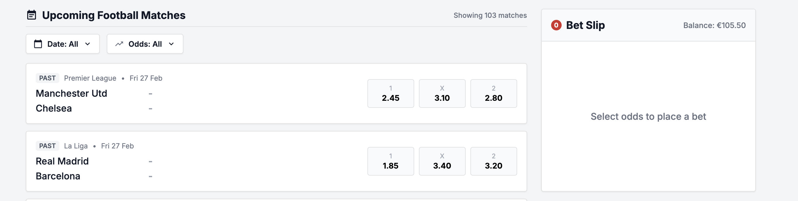
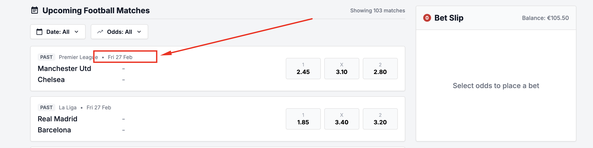
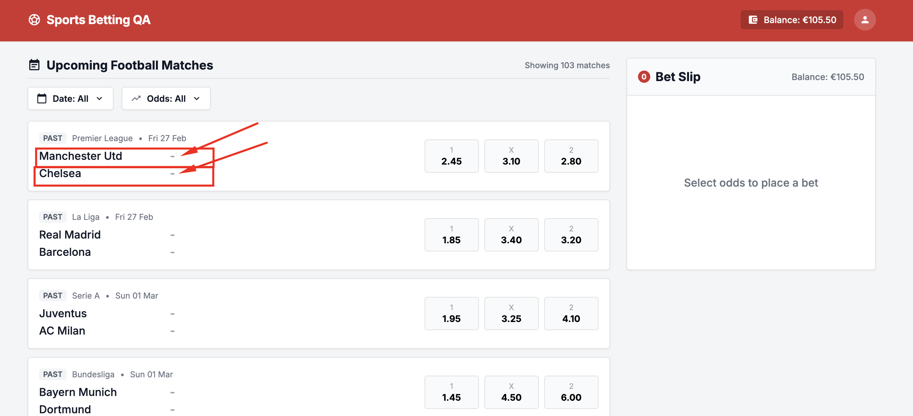
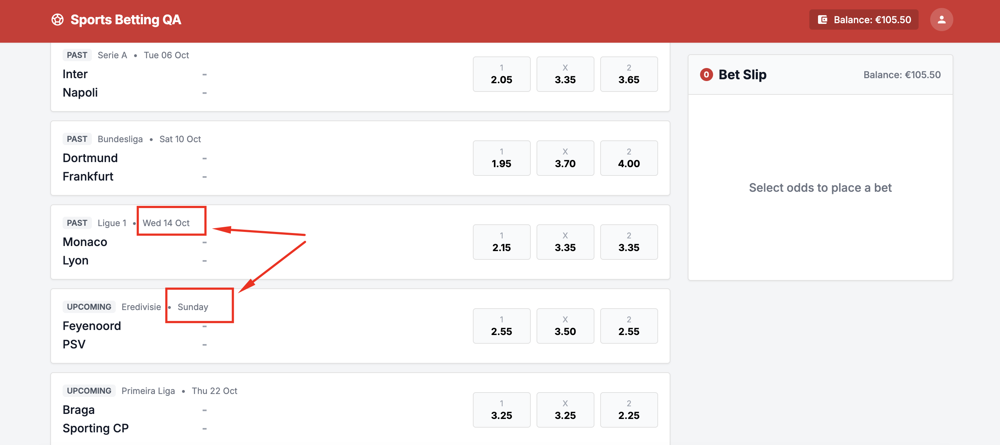
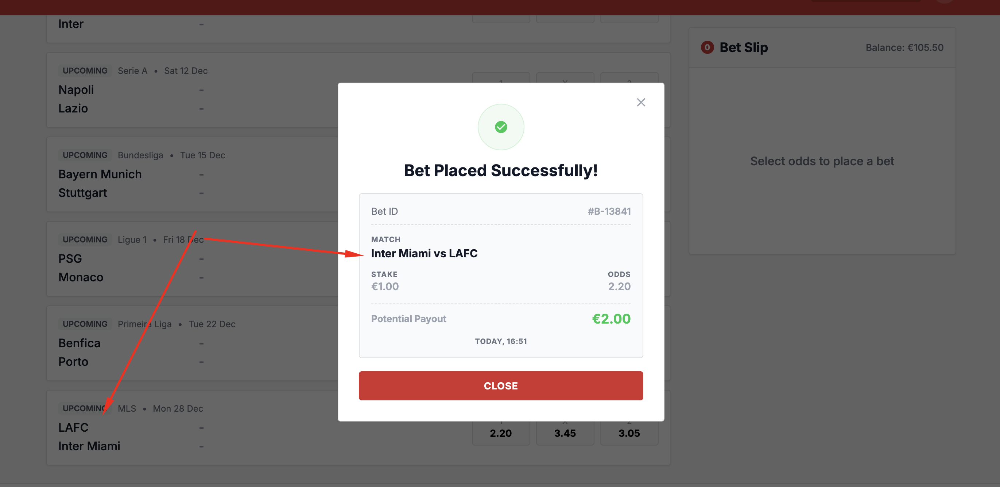
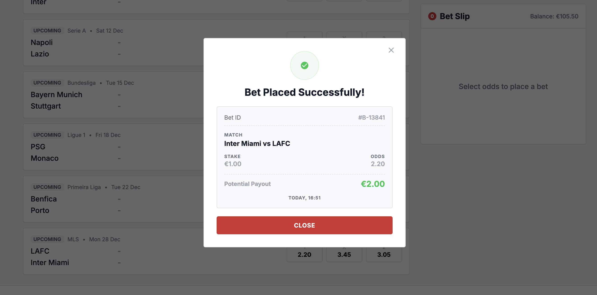

# Bug Report

## BUG-001 — Past events appear in Upcoming Football Matches

**Severity:** High

**Reproduction Steps**
1. Open the Upcoming Football Matches list.
2. Inspect the kickoff date/time of the listed events.
3. Compare them with the current date and time. (pay attention to the time zone too)

**Expected vs Actual result:** 
Expected: The list should show only events that have not started. 
Actual: Past events are displayed

**Business Impact:** Users may select events whose outcomes may already be known, undermining trust and the integrity of betting.

**Evidence:** 

## BUG-002 — Match list does not display kickoff time

**Severity:** High

**Reproduction Steps**
1. Open the Upcoming Football Matches list.
2. Inspect the date/time information for a listed event.

**Expected vs Actual result:** Each event should display its kickoff date and time consistently. The list displays only the date.

**Business Impact:** Users cannot tell when an event starts or reliably determine whether it is still upcoming.

**Evidence:** 

## BUG-003 — Away team appears on a separate line

**Severity:** Low

**Reproduction Steps**
1. Open the match list.
2. Inspect the home and away team names for an event.

**Expected vs Actual result:** The teams should appear together as `HOME TEAM - AWAY TEAM`. The away team is displayed on a new line.

**Business Impact:** The unexpected layout makes matchups harder to scan and may cause confusion about the fixture.

**Evidence:** 

## BUG-004 — Match date is inconsistently formatted

**Severity:** Medium

**Reproduction Steps**
1. Open the match list.
2. Compare the displayed dates across events, including Feyenoord - PSV.

**Expected vs Actual result:** Event dates should use a consistent, unambiguous date format. Feyenoord - PSV is displayed as “Sunday” while other events use a different date format.

**Business Impact:** An ambiguous or inconsistent date can make users misjudge when a match takes place.

**Evidence:** 

## BUG-005 — Bet can be placed on a past event

**Severity:** Critical

**Reproduction Steps**
1. Find a past event in the match list.
2. Select one of its odds.
3. Enter a valid stake and submit the bet.

**Expected vs Actual result:** Bets on past or started events should be blocked, including by server-side eligibility checks. A bet on a past event is accepted.

**Business Impact:** Accepting bets after an event has started/ended creates serious financial, fairness, and regulatory risk.

**Evidence:** This would require a video ... just to save time I skipped that

## BUG-006 — Potential payout is always shown as €2.00

**Severity:** Critical

**Reproduction Steps**
1. Select an event outcome and note its odds.
2. Enter a valid stake.
3. Place a bet and check the receipt (in modal)
4. Repeat with a different stake or odds value.

**Expected vs Actual result:** Potential payout should reflect the accepted stake and odds using the product's rounding rules. It remains €2.00 regardless of the entered stake or selected odds.

**Business Impact:** Incorrect payout information can mislead users about the return on a bet and undermine confidence in the product.

**Evidence:** this requires a video.. I avoid that to avoid spending too much time on this task

## BUG-007 — Balance does not update immediately after bet placement

**Severity:** Medium

**Reproduction Steps**
1. Note the displayed balance.
2. Place a valid bet.
3. Inspect the balance without refreshing the page.
4. Refresh the page and inspect the balance again.

**Expected vs Actual result:** The balance should update immediately after successful placement and remain consistent after refresh. It changes only after the page is refreshed.

**Business Impact:** A stale balance can confuse users about whether their bet was accepted and how much money remains available.

**Evidence:** this requires a video.. I avoid that to avoid spending too much time on this task

## BUG-008 — Bet receipt reverses home and away teams

**Severity:** Critical

**Reproduction Steps**
1. Select an outcome for a match with clearly identified home and away teams.
2. Place a valid bet.
3. Compare the match teams on the receipt with the match list.

**Expected vs Actual result:** The receipt should show the home and away teams in the same order as the match listing. It shows the away team as home and the home team as away.

**Business Impact:** A receipt that misidentifies the fixture may cause users to doubt which event, or which team their bet applies to and complicate support or dispute handling. 

**Evidence:** 

## BUG-010 — Bet receipt omits match kickoff date and time

**Severity:** Medium

**Reproduction Steps**
1. Place a valid bet on an upcoming event.
2. Inspect the resulting bet receipt.

**Expected vs Actual result:** The receipt should identify the event's kickoff date and time. The kickoff date and time are missing.

**Business Impact:** Users may have difficulty confirming the exact event associated with a bet, especially when teams play more than once.

**Evidence:** 